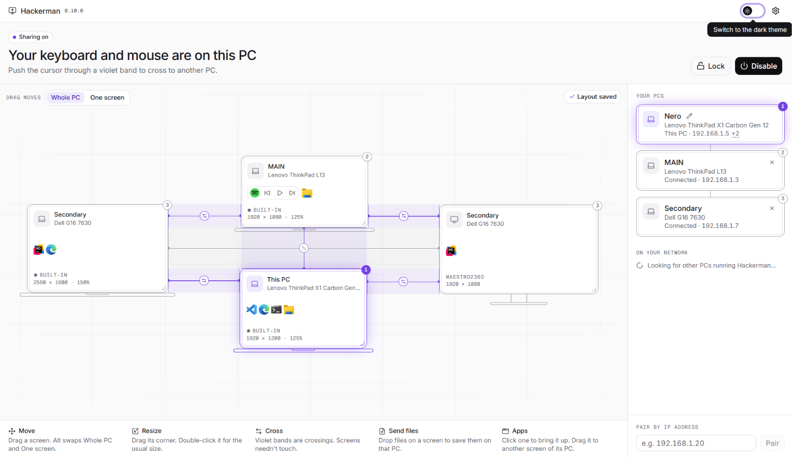

# Hackerman

Share one keyboard and mouse across several computers on your network. Move the
cursor off the edge of one screen and it appears on the next computer.

[](https://github.com/medAmarFilali/hackerman/releases/latest)
[](https://github.com/medAmarFilali/hackerman/actions/workflows/ci.yml)
[](#license)

**[Download for Windows](https://github.com/medAmarFilali/hackerman/releases/latest)** · free and
open source · no account · no server



Hackerman is built for desks with many monitors:

- **Free-form layout.** Drag every monitor of every computer onto one canvas, at
  any size, offset or stacking, with gaps between them if you like.
- **Per-edge routing.** The canvas decides where the cursor goes: straight out from
  an edge to the next screen, however far away. The left monitor of one PC can lead
  to a laptop while its top edge leads to a third machine.
- **Computers between a computer's screens.** If two laptops sit between the two
  screens of a desktop, draw them that way and the cursor goes through the laptops
  rather than jumping across as Windows would.
- **DPI-correct crossing.** The cursor keeps its visual position when moving between
  monitors with different resolutions or scaling.
- **Survives hot-plug.** Monitors are remembered by hardware ID, so docking,
  undocking and replugging restore your layout instead of breaking it. Each set of
  monitors keeps its own arrangement, and a monitor moved to another port keeps its
  place. The canvas says whether the layout is saved for the screens there are now.
- **No setup by IP address.** Computers find each other on the network, and you pair
  them with a 6-digit code. All traffic is encrypted, and only paired computers can
  connect.

It also shares the clipboard (text, formatted text, images and files of any size), has
keyboard shortcuts for jumping between computers and for keeping the cursor where it is, and
can hold the cursor back during full-screen games or until you push against an edge.
You can drop files on a screen to save them on that computer, see what's on each screen, and
bring up apps or move them between screens from the canvas. One button turns all of it off on
a computer, and there are light and dark themes.

> **Status:** early development, Windows only so far. Dragging a file straight across from
> one computer's screen to another's, the Windows login screen, and macOS and Linux are
> planned.

## Download and set up

Windows 10 or 11 (64-bit), on two or more computers on the same network.

1. On each computer, get the installer, `Hackerman_x.y.z_x64-setup.exe`, from the
   [latest release](https://github.com/medAmarFilali/hackerman/releases/latest), and run it. If
   you'd rather not install anything, the `portable.zip` there has a `hackerman.exe` that
   runs as it is, on any computer that has Microsoft Edge WebView2, as Windows 11 does.
2. These builds aren't code-signed yet, so Windows may say **Windows protected your PC**. Choose
   **More info**, then **Run anyway**. Some antivirus programs may also object, since a program
   that shares a keyboard and mouse has to watch and send input. See
   [Checking a download](#checking-a-download).
3. When Windows Firewall asks, **allow it on private networks**. If your network is
   set to Public in Windows, set it to Private: the firewall otherwise blocks other
   computers from finding this one.
4. The computers appear under **On your network**, with their make and model when
   Windows knows them. Click **Pair** on one of them, and type the code that appears on
   the other. If one doesn't appear, pair by typing its IP address, which is shown under
   **This PC** on that computer.
5. Drag the screens on the canvas. A violet band is where your cursor can cross.
6. Push the cursor through a violet band. **Ctrl+Alt+Home** always brings control
   back, and it also comes back by itself if the connection drops.

Pairing is a real decision: a paired computer can type and click on this one. [SECURITY.md](SECURITY.md)
says exactly what it can do.

### Updating and uninstalling

Hackerman doesn't update itself or contact anything outside your network, so watch the
[releases page](https://github.com/medAmarFilali/hackerman/releases) for new versions. To update,
run the new installer over the old one. To uninstall, use **Installed apps** in Windows' settings.

### Checking a download

Each release is built from its tagged source by [GitHub Actions](.github/workflows/release.yml), in
the open. `SHA256SUMS.txt` on the release lists what each file should hash to:

```powershell
Get-FileHash .\Hackerman_x.y.z_x64-setup.exe -Algorithm SHA256
```

With the [GitHub CLI](https://cli.github.com), you can also check that a file really was built by
this repository's workflow:

```sh
gh attestation verify Hackerman_x.y.z_x64-setup.exe --repo medAmarFilali/hackerman
```

With three or more computers, pair each one with every other. The cursor can cross
between computers that are only paired through a third, but the clipboard and files go
directly from one computer to another.

Computers don't have to be updated together. Anything from version 0.4.0 on works with
anything newer, and a feature an older one doesn't have simply isn't offered to it.
Versions before 0.4.0 need updating once, and they say so instead of connecting.

Closing the window keeps Hackerman running in the tray. To stop it, right-click the
tray icon and choose **Quit**.

### Arranging the screens

- **Moving.** Dragging a screen moves all the screens of its computer. Choose **One
  screen** above the canvas to move just the one you drag. Holding Alt does the opposite
  of whichever is chosen.
- **Gaps.** Screens don't have to touch. The cursor leaves an edge and arrives on the
  nearest screen straight out from it, at the same height on the canvas, so two screens
  connect wherever they line up. Where nothing lines up, the edge is a wall. Computers
  that are offline are skipped, so what's beyond them stays reachable.
- **Splitting a computer.** The canvas takes priority over how Windows arranges a
  computer's own screens. Windows' arrangement only applies at edges with nothing beyond
  them on the canvas.
- **Resizing.** Drag a screen's bottom-right corner to change how large it's drawn,
  which keeps its shape. This changes how screens line up, so the cursor can keep its
  place between screens of different physical sizes. It doesn't change the screen
  itself. Double-click the corner to go back to the usual size.

On the keyboard, select a screen with Tab, then use the arrow keys to move it (Shift for
bigger steps), **+** and **-** to resize it, and **0** for the usual size.

Bands in grey connect two screens of the same computer, or lead to one that's offline.

The number on each screen is the computer's shortcut: **Ctrl+Alt** and that number
jumps there. The keyboards drawn under laptops and the stands drawn under monitors can
be turned off in **Settings**.

### Turning it off

**Disable**, at the top of the window or in the tray menu, stops everything on that
computer until you press **Enable**, and it stays that way after a restart:

- Its input hooks are removed, so it keeps its own keyboard and mouse.
- It ignores input and clipboards from other computers. If one was controlling it, the
  cursor goes back there.
- The others show it as disabled, and their cursors pass over it to whatever is beyond.

Screens can still be arranged while it's off.

### The clipboard

Copy on one computer and paste on the one your cursor moves to. What you copy only
travels when you arrive at another computer, so it doesn't spread to computers you
aren't using. Anything a password manager marks as private is never shared.

**Files** work the same way, at any size. Copy files or folders in File Explorer, move to
the other computer, and paste them in File Explorer there, with its usual progress and
its usual questions about name clashes:

- Only the list of files moves when the cursor arrives. The content moves when you paste,
  straight to where you pasted it, with no temporary copy.
- If the connection drops for a moment, the paste carries on from where it was. It gives
  up after 30 seconds without a connection.
- Cutting works like copying: the originals stay where they are.
- Pasting needs a program that takes what Windows calls virtual files. File Explorer does,
  but some programs that take a file copied from File Explorer don't.
- Other computers can only read files you copied, and nothing else on your computer.

**Sending files by dropping them.** Drag files or folders from File Explorer onto a screen
on the canvas, or onto a computer in the list, and they're saved on that computer. They go
on its Desktop, or in another folder chosen under **Settings > Clipboard & files** on that
computer. Progress shows under **Files** at both ends, and either end can cancel. A file
appears under its real name only once it's complete.

The first time a computer sends files, the receiving computer asks. You can turn them down,
accept them just this time, or always allow that computer. **Settings > Clipboard & files**
lists the computers you've allowed and can take that back. It can also ask every time, save
files from any paired computer straight away, or turn them all away.

When files have arrived, a Windows notification says so, with a button to open the folder,
unless Hackerman's window is in front. That can be turned off in the same place.

What's copied on a disabled computer stays there, and enabling it doesn't replace that
with anything copied elsewhere in the meantime. Whatever is copied next travels as
usual.

### What's open, and what's playing

Each screen on the canvas shows the icons of the apps open on it, on every computer. Faded
ones are minimized. Only the names and icons of apps are sent, never window titles or
anything in the windows.

A screen with something playing on it has back, pause and forward buttons, for players that
tell Windows what they're doing, such as Spotify or a video in a browser, and for Stremio. An
app playing from the tray has them on the computer's main screen. Forward and back skip to the
next or previous track. Where there isn't one, as with a film, they go 10 seconds either way.

Stremio doesn't tell Windows what it's doing, so its button can't show whether it's playing,
and it's sent Stremio's own keys: Space and the left and right arrows.

**Clicking an app** brings it to the front on the computer it's on, and restores it if it's
minimized. If it has windows on several screens, that's its window on the screen you clicked.

**Dragging an app** to another screen of the same computer moves its windows from that screen
there, whether they're normal, maximized or minimized. It can't go to another computer's screen,
as its windows belong to that computer. Windows doesn't let an ordinary program move an
administrator's window, so those stay where they are unless Hackerman is running as
administrator there.

**Settings > Apps & media** turns the icons and the buttons off, on this computer's canvas, and
can stop other computers seeing what's open here, controlling what's playing here, or bringing up
and moving apps here. A locked computer does none of these. All your computers need this version
for any of this.

### What's on the screens

Each screen on the canvas can show a live picture of what's on it, about once a second. The button
at its top right, double-clicking it, or Enter with it selected opens it larger, with about ten
pictures a second and the cursor showing. It's for looking at: to use that computer, move the
cursor there.

**Nothing leaves a computer until you say so.** To see a computer's screens from another one, open
Hackerman on the computer to be seen, go to **Settings > Screens**, and turn it on for the computer
doing the looking. It's one switch for each computer, in one direction, and forgetting a computer
takes it back.

- A computer being looked at says so at the top of Hackerman's window, with a button to stop it,
  and when pointing at the tray icon. It also shows one Windows notification the first time for
  each computer, each time Hackerman starts.
- Anything on the screen can be seen, including private messages and whatever's being typed.
- Pictures are only taken while the window of the computer looking is open and not minimized. With
  the window closed to the tray, nothing is taken at all.
- Nothing can be seen of a locked computer, a sign-in screen, or an administrator prompt, and nothing
  of a computer that's disabled. Programs can also keep their windows out of pictures, and films
  protected against copying usually show as black.
- Pictures go directly between the two computers, encrypted, and aren't saved anywhere.
- It doesn't get in the way of the mouse: pictures are sent after input, and are skipped if nothing
  on the screen has changed.

**Show what's on the screens** in the same place turns the pictures off on this computer's canvas.
A screen being looked at from here can't be clicked on, and a computer can't be used as an extra
monitor for another: that takes a display driver, which is a project of its own.

All the computers involved need this version.

### Keyboard shortcuts

| Keys | What they do |
|---|---|
| **Ctrl+Alt+L** | Keep the cursor on the computer it's on now, or stop doing that |
| **Ctrl+Alt+1** | Jump to this computer |
| **Ctrl+Alt+2** and up | Jump to a paired computer, as listed in **Settings** |
| **Ctrl+Alt+Home** | Come back to this computer, whatever is happening |
| **Ctrl+Alt+Space** | Play or pause |
| **Ctrl+Alt+Page Up** | Back |
| **Ctrl+Alt+Page Down** | Forward |

Use the left Alt key. AltGr stays free for typing characters such as @ and #.

The last three can be changed or turned off in **Settings > Shortcuts**, on the computer whose
keyboard you're using. They work wherever the cursor is, on whatever is playing on any of your
computers. If several things are playing, that's the one that started last. With nothing
playing, it's whatever they were last used on, so the shortcut that paused something starts it
again. With nothing that can be played anywhere, those keys go to the program in front as usual.

### If the keyboard and mouse freeze

Another program that shares a keyboard and mouse, such as Input Director, sits in the way of
the same key presses. Two of them can hold each other up, so Hackerman says if it finds one
running. Quit or uninstall the one you aren't using, on each computer. For Input Director that
includes its service, which keeps running in the background.

Clicking a Windows notification leaves the keyboard with nothing in front, until you click a
window. That's Windows, and it happens without Hackerman too.

The log says what it saw: whether input took a long time to reach Hackerman or to reach Windows,
whether Windows removed Hackerman's input hooks (they're put back within seconds), and whether
Windows refused input from another computer. Look in the log of the computer with the keyboard,
and of the one the cursor was on.

### Known limits for now

- Input can't reach administrator windows, the lock screen or the login screen.
  Running Hackerman as administrator handles administrator windows, but Windows then
  stops you dragging files into it from an ordinary File Explorer window.
- A computer's input can't be captured while one of its own administrator windows
  has focus, unless Hackerman is running as administrator there.
- Games that read raw mouse movement may not respond to the mouse, because it's sent
  as positions.
- Ctrl+Alt+Del always goes to the computer you pressed it on.

If something goes wrong, the log is at `%APPDATA%\Hackerman\agent.log`.

## Building

You need stable Rust, Node.js and pnpm. On Windows, use the MSVC toolchain
(`stable-x86_64-pc-windows-msvc`) with the Visual Studio C++ Build Tools.

```sh
cd app
pnpm install
pnpm tauri dev      # run the app during development
pnpm tauri build    # hackerman.exe and an installer, in target/release
```

To test:

```sh
cargo test --workspace --exclude hackerman-app
(cd app && pnpm test)

# These use the real cursor and input hooks on your computer, with the screen unlocked.
# The clipboard ones would replace what you've copied, so skip them here.
cargo test -p hk-platform -- --ignored --test-threads=1 --skip clipboard --skip copies_by
```

The clipboard tests can run in a private, hidden window station, which has its own
clipboard. Pass it the test program that `cargo test -p hk-platform --no-run` names. The
second line here also pastes files with Windows' own code, and the slow test pastes a 4.5 GB
file to the temporary folder:

```powershell
.\scripts\run-isolated.ps1 -Exe <full path to the test program> `
  -Arguments "--ignored --test-threads=1 clipboard copies_by windows_pastes_these_files pasted_in_another_program" `
  -Output $env:TEMP\isolated.out
.\scripts\run-isolated.ps1 -Exe <full path to the test program> -TimeoutSeconds 600 `
  -Arguments "--ignored --test-threads=1 windows_pastes_a_file_over_4_gb" -Output $env:TEMP\isolated.out
```

`hackerman-daemon` runs the background agent from a terminal. Its `--simulate <count>`
option pretends to be a computer with that many monitors, which lets you try pairing
and the layout with only one real computer:

```sh
cargo run -p hk-daemon -- --simulate 2 --config-dir some/empty/folder --port 24860 --channel '\\.\pipe\hackerman-sim'
```

## The lock screen

Hackerman can also work at the lock screen and the sign-in screen, so that you can type your
password from another PC, even right after a restart. Turn it on for each PC under
**Settings > General > Work at the lock screen**. Windows asks for administrator permission,
because this takes a small service running as the system. It's copied to
`C:\Program Files\Hackerman Lock Screen`, and it keeps a copy of Hackerman's settings where only
administrators can read it. It uses the settings of whoever turned it on, whoever else signs in.

Before you turn it on:

- **Using a paired PC becomes like sitting at this one's keyboard**, even before anyone has
  signed in. Only turn it on if you'd trust everyone who uses your paired PCs with that.
- **Only the PCs you approve can reach it.** Turning it on approves the PCs you're paired with
  then. A PC you pair later can't reach the lock screen until you allow it in the same place, which
  also takes administrator permission. Forgetting a PC takes it off straight away.
- **A locked PC only receives.** Its own keyboard and mouse can't cross to your other PCs until
  it's unlocked, and nothing it does can get in the way of typing on it. The clipboard and files
  aren't shared while it's locked, and locking a PC stops any file transfer it's in the middle of.
  Files copied from another PC have to be copied again after unlocking.
- **It doesn't reach administrator prompts** on a PC that's in use, or send Ctrl+Alt+Del. If
  sign-in is set to require Ctrl+Alt+Del, you'd have to press that on the PC itself.
- **The Disable button still applies.** A disabled PC accepts nothing at the lock screen either.
  The copy of the settings catches up within about ten seconds of a change.
- **After updating Hackerman**, Settings offers to update it as well.

Turning the switch off removes all of it, and so does uninstalling Hackerman.

## Layout

| Path | Purpose |
|---|---|
| `crates/hk-core` | Monitor layout, crossing logic, and the switcher that decides which computer gets input. Pure Rust, no OS calls. |
| `crates/hk-proto` | Messages exchanged between computers and their binary encoding. |
| `crates/hk-net` | Encrypted QUIC links, device identities, pairing and network discovery. |
| `crates/hk-platform` | Input capture and replay, the monitors, apps' windows and pictures of the screens. Windows only so far. |
| `crates/hk-ipc` | The private local channel between the app and the agent. |
| `crates/hk-daemon` | The background agent, which ties everything together. |
| `crates/hk-win-service` | The optional Windows service that makes the lock screen work. |
| `app` | The desktop app: Tauri, React, TypeScript and shadcn/ui. |

## Contributing

Bug reports, fixes and ideas are welcome: see [CONTRIBUTING.md](CONTRIBUTING.md). For a security
problem, see [SECURITY.md](SECURITY.md). What changed in each version is in
[CHANGELOG.md](CHANGELOG.md).

## License

Licensed under either of

- Apache License, Version 2.0 ([LICENSE-APACHE](LICENSE-APACHE))
- MIT license ([LICENSE-MIT](LICENSE-MIT))

at your option. The open-source components it's built from are listed in
[THIRD-PARTY-NOTICES.md](THIRD-PARTY-NOTICES.md).

Unless you explicitly state otherwise, any contribution intentionally submitted for
inclusion in the work by you, as defined in the Apache-2.0 license, shall be dual
licensed as above, without any additional terms or conditions.
